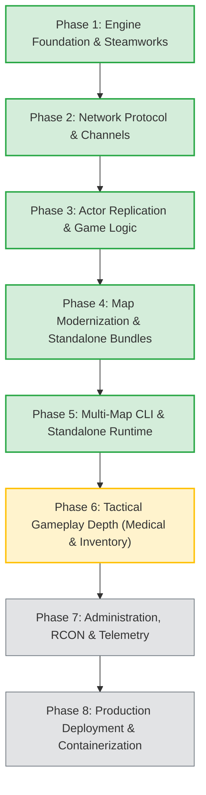

# America's Army 3 Linux Dedicated Server — Implementation Roadmap

**Document Version**: 2.0  
**Last Updated**: 2026-10-10  
**Overall Status**: ✅ Phases 1–5 Complete; Phase 6 (Gameplay Depth) Next

---

## 1. Project Vision & Goals

The goal of this project is to provide a modern, high-performance, headless Linux dedicated server (`aa3_server`) for America's Army 3, completely decoupled from legacy Windows dependencies and client-side cooked packages:

1. **Standalone Operation**: Zero requirement for proprietary 1.2+ GB client packages; all spatial, collision, and mission data is unified in modern `.aa3map` binary containers.
2. **UE3 Protocol Fidelity**: Reverse-engineered Unreal Engine 3 (v568) bunch-based reliable channel multiplexing and binary bitstream packing.
3. **Dual Authentication**: Seamless Steamworks SDK integration for authenticated public servers alongside `--standalone` mode for LAN and direct-IP communities.
4. **Server-Authoritative Gameplay**: Authoritative movement, posture validation (stand, crouch, prone, sprint, vault, mantle, ladder), hitscan ballistics, skeletal hit registration, and round state machines.
5. **High-Performance Spatial Collision**: Sub-millisecond BVH ray tracing against instanced, 16-bit quantized static meshes, terrain heightfields, and BSP geometry.
6. **Full Map Roster Support**: All 18 retail AA3 base maps baked, tested, and playable via `--map <name>` CLI parameter.

---

## 2. Milestone & Phase Breakdown

---

### Phase 1: Engine Foundation & Steamworks Integration ✅ COMPLETE

- **CMake Build System**: Modular modern CMake build supporting C++17, sanitizer configs, and automated test harnesses.
- **Engine Core & Tick Loop**: Configurable 60 Hz high-resolution main engine loop with delta-time clamping and accumulator stepping.
- **Steamworks SDK Layer**: [`SteamAuthManager`](file:///home/odeyin/Documents/AA3/standAlone-aa3-linuxServer/include/auth/steam_auth.h) integrating `ISteamGameServer` authentication, Steam IDs, token validation, and ban callbacks.
- **Standalone LAN Mode**: Fallback mode allowing server execution without Steamworks binaries or active internet access.
- **Logging Subsystem**: Thread-safe tiered logging (`DEBUG`, `INFO`, `WARN`, `ERROR`) with millisecond timestamps and channel prefixes.

---

### Phase 2: UE3 Network Handshake & Reliable Channels ✅ COMPLETE

- **UDP Socket Abstraction**: Non-blocking asynchronous socket wrapper managing MTU fragmentation, buffering, and packet sequencing.
- **Channel 0 Handshake**: Full implementation of UE3 v568 connection handshake (`NMT_Hello`, `NMT_Challenge`, `NMT_Welcome`, and `NMT_NetGUIDs`).
- **Reliable Bunches & Multiplexing**: Reliable bunch fragmentation, channel sequence numbering (`ChIndex`, `bOpen`, `bClose`, `bReliable`), packet acknowledgments, and resend queues.
- **Network Byte Remapping**: Reverse-engineered opcode remap tables matching retail AA3 client expectations.

---

### Phase 3: Actor Replication & Core Game Logic ✅ COMPLETE

- **Replication Layouts**: Dedicated replication property layouts (`RepLayout`) for `WorldInfo`, `GameReplicationInfo`, `TeamInfo`, `PlayerReplicationInfo`, `PlayerController`, `Pawn`, and inventory actors.
- **Role & Loadout Ingestion**: 26-slot AA3 Infantry Combat Team hierarchy (Squad Leader + Alpha/Bravo/Charlie fireteams) with authentic weapon classes, magazines, and IFAK supplies.
- **Movement & Posture Controller**: Client RPC handling for posture transitions (walk, sprint, crouch, prone, vault, mantle, ladder) and position validation.
- **Hitscan Ballistics & Damage**: Ray-trace hitscan calculation, skeletal hitbox location mapping (head, torso, extremities), bleed rates, and incapacitation.
- **Match State Machine**: Complete match and round lifecycle (`PreRound`, `RoundActive`, `RoundEnding`, `PostRound`) with win-condition evaluation (elimination vs objective completion).

---

### Phase 4: Map Modernization & Standalone Architecture ✅ COMPLETE

Eliminated server dependence on 1.2+ GB of proprietary Unreal packages by developing a unified binary container pipeline:

- **4.0 Unified Binary Container (`AA3MAP01`)**: Consolidated 7+ loose files into a single binary bundle with 64-byte aligned sections and zero-copy `mmap` loading (< 5 ms load time).
- **4.1 Instanced BLAS/TLAS Acceleration (`AA3COL03`)**: Decoupled 517 unique static mesh collision hulls (BLAS) from 4,622 placed instances (TLAS), cutting raw Bridge collision from 69.18 MB to 19.49 MB with 100% ray-trace parity.
- **4.2 Direct C++ Package Extractor**: Built native [`PackageExtractor`](file:///home/odeyin/Documents/AA3/standAlone-aa3-linuxServer/src/engine/package_extractor.cpp), reading UE3 v568 cooked packages directly in 58 ms without external scripts.
- **4.3 16-Bit Quantized Mesh Compression (`AA3COL04`)**: Quantized vertex coordinates to unsigned 16-bit integers and packed triangle indices to `uint16_t`, cutting mesh geometry by 75.5% while maintaining sub-centimeter ray accuracy.
- **4.4 Native Mission & Sublevel Extraction**: Ingested level actors, doors, breakable windows, interactive markers, and fireteam hierarchies directly from packages.
- **4.5 Batch Retail Baking**: Baked all 18 base retail maps into `data/maps/*.aa3map`, occupying only 195 MB total (a 6.1x compression ratio vs original 1.2 GB cooked packages).

---

### Phase 5: Multi-Map Standalone Execution & CLI Runtime ✅ COMPLETE

- **Multi-Map CLI**: Added `--map <name>` / `-m <name>` argument enabling instant boot of any retail map from the catalog.
- **Runtime Bundle Loader**: Integrated [`MapBundle`](file:///home/odeyin/Documents/AA3/standAlone-aa3-linuxServer/include/engine/map_bundle.h) directly into server initialization, seamlessly constructing BVH trees and round actors at launch.
- **Automated Regression Suite**: 4 CTest test suites verifying collision parity, package extraction, quantized precision, and mission data with 100% pass rates.

---

### Phase 6: Gameplay Depth & Tactical Mechanics 🔄 IN PROGRESS / NEXT

Building out advanced combat realism systems authentic to America's Army 3:

- **Medical Treatment & Revive Sequence**:
  - Interactive IFAK triage: apply tourniquet to limbs, apply pressure dressing to torso, administer saline for blood volume loss.
  - Incapacitated state timers, bleed-out rates, and field resuscitation.
- **Dropped Weapon & Inventory Pickups**:
  - Spawning dropped weapon actors with remaining magazine state upon player death or drop action.
  - Interactive pickup traces and inventory attachment.
- **Dynamic Obstacle & Door Synchronization**:
  - Replicate door swing states (`AA_Door`), latches, and breaches across reliable actor bunches.
  - Interactive breakable window shattering and collision removal.

---

### Phase 7: Dedicated Server Admin & Telemetry ⏳ PLANNED

- **RCON Protocol**: Authenticated TCP/UDP remote console interface for server administration.
- **Administrative Commands**: Kick, ban, map rotation change, match restart, time limit override, and broadcast messaging.
- **Security & Access Control**: IP whitelist/blacklist, GUID bans, and rate-limiting.
- **Telemetry & Stats**: Periodic JSON/Prometheus metrics exporter (tick rate, packet loss, bandwidth, player latency, active collisions).

---

### Phase 8: Production Deployment & Containerization ⏳ PLANNED

- **Docker Containerization**: Minimal multi-stage Debian/Alpine runtime image (< 80 MB base) bundling the compiled binary and `data/maps/`.
- **Systemd Service Integration**: Service unit files with `Restart=always`, resource limits (`LimitNOFILE`), and graceful SIGTERM handling.
- **Automated CI/CD**: GitHub Actions workflow for automated compilation, test execution (`ctest`), and release artifact packaging.

---

## 3. Project Roadmap Summary Table

| Phase | Description | Deliverables | Status | Tests / Verification |
|---|---|---|---|---|
| **Phase 1** | Foundation & Steamworks | CMake, 60 Hz loop, `SteamAuthManager`, Config, Logging | ✅ COMPLETE | Server boots, Steam callbacks functional |
| **Phase 2** | Network Protocol & Bunches | Handshake, Channel 0, Reliable bunches, Opcode remap | ✅ COMPLETE | Client connection captures pass handshake |
| **Phase 3** | Actor Replication & Game Logic | RepLayouts, Squad/Roles, Movement, Hitscan ballistics | ✅ COMPLETE | Character postures, hitboxes, round timer |
| **Phase 4** | Map Modernization Pipeline | `AA3MAP01` container, BLAS/TLAS (`AA3COL03`), Quantization (`AA3COL04`), C++ Extractor | ✅ COMPLETE | 4 CTest suites pass (100%), 18 retail maps baked |
| **Phase 5** | Multi-Map Standalone Execution | CLI `--map <name>`, zero-package runtime, live loading | ✅ COMPLETE | All 18 maps boot cleanly in headless mode |
| **Phase 6** | Gameplay Depth & Tactical Mechanics | Medical triage/revive, dropped weapons, door states | 🔄 IN PROGRESS | Unit tests for IFAK state machine |
| **Phase 7** | Administration & Telemetry | RCON protocol, ban/kick commands, metric exports | ⏳ PLANNED | RCON client integration tests |
| **Phase 8** | Deployment & Containerization | Dockerfile, systemd service, GitHub Actions CI | ⏳ PLANNED | Container startup and headless healthcheck |

---

## 4. Key Architectural Decisions

1. **Standalone `.aa3map` Containers vs Cooked Packages**:
   - *Decision*: Headless server uses offline-baked `.aa3map` containers rather than loading proprietary cooked Unreal packages at runtime.
   - *Rationale*: Cuts server data footprint from 1.2+ GB to 195 MB, eliminates licensing and distribution liabilities, and loads memory-mapped data in < 5 ms.

2. **BLAS / TLAS Instanced Collision Hierarchy**:
   - *Decision*: Separate unique meshes into local-space BLAS and placed instances into TLAS transforms.
   - *Rationale*: Eliminates redundant geometry coordinates, speeds up BVH tree generation from 362 ms to 72 ms, and cuts collision memory by 75%.

3. **16-Bit Quantized Coordinates (`AA3COL04`)**:
   - *Decision*: Compress mesh-local vertex coordinates into 16-bit integers relative to mesh bounding bounds.
   - *Rationale*: Cuts coordinate storage by 50% with sub-centimeter delta error, proving 100% ray-trace parity across 2,000 randomized test rays.

4. **POSIX `mmap` Zero-Copy Page Sharing**:
   - *Decision*: Map file bundles using `mmap(..., MAP_SHARED)`.
   - *Rationale*: Multiple game server instances running on the same Linux host share identical physical memory pages for map collision geometry.

---

## 5. Verification & Testing Strategy

Continuous automated testing is enforced via `ctest`:

- **Collision Parity Test** ([`tests/collision_parity_test.cpp`](file:///home/odeyin/Documents/AA3/standAlone-aa3-linuxServer/tests/collision_parity_test.cpp)): Validates BLAS/TLAS ray intersection against raw uninstanced geometry across 2,000 rays with 100% agreement.
- **Package Extractor Test** ([`tests/package_extractor_test.cpp`](file:///home/odeyin/Documents/AA3/standAlone-aa3-linuxServer/tests/package_extractor_test.cpp)): Validates direct UE3 v568 package extraction for StaticMesh LOD0 buffers, kDOP hulls, and BSP geometry.
- **Collision Quantization Test** ([`tests/collision_quant_test.cpp`](file:///home/odeyin/Documents/AA3/standAlone-aa3-linuxServer/tests/collision_quant_test.cpp)): Confirms 16-bit coordinate quantization preserves ray hit detection with zero false negatives and sub-centimeter accuracy.
- **Mission Extraction Test** ([`tests/mission_extraction_test.cpp`](file:///home/odeyin/Documents/AA3/standAlone-aa3-linuxServer/tests/mission_extraction_test.cpp)): Verifies extraction of the full 26-slot Infantry Combat Team hierarchy, extraction zones, and interactive map entities.
